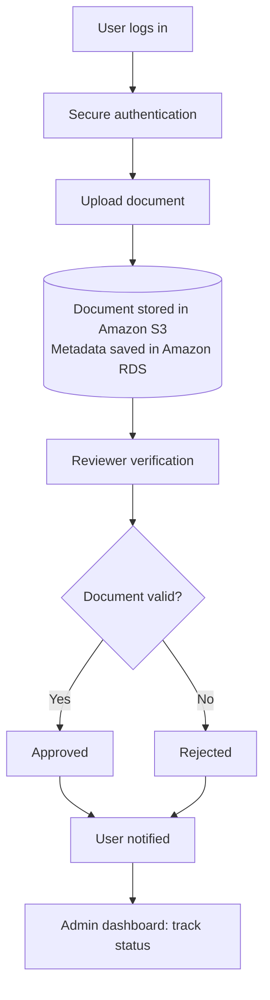
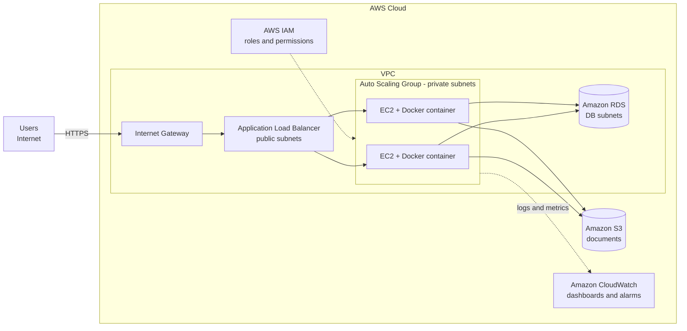

# Cloud-Based Document Verification and Approval Workflow System

A web-based document workflow application where users submit documents, authorized reviewers verify them, and administrators track approval or rejection status. It is designed for deployment on AWS using Docker on EC2 with Auto Scaling and load balancing.

> College project, AWS Cloud Computing.

## Team

| Name | Student ID |
|------|------------|
| J. Chandra Hasini | 2520030086 |
| S. Vaibhava Sree | 2520030398 |
| Simran Jangid | 2520030166 |

## Table of Contents

- [Overview](#overview)
- [Problem Statement](#problem-statement)
- [Features](#features)
- [User Roles](#user-roles)
- [Document Approval Workflow](#document-approval-workflow)
- [AWS Services Used](#aws-services-used)
- [Architecture](#architecture)
- [Network and Security Design](#network-and-security-design)
- [Monitoring and Logging](#monitoring-and-logging)
- [Getting Started](#getting-started)
- [Project Structure](#project-structure)
- [Conclusion](#conclusion)

## Overview

Traditional document verification relies on paperwork, emails and manual follow-ups, which causes delays, lost documents and no clear view of status. This project moves the whole process online:

- Users upload documents securely.
- Authorized reviewers examine them and approve or reject them with remarks.
- Administrators monitor document status and manage users.
- AWS services provide secure storage, scalability, availability and monitoring.

**Main goal:** a secure, scalable and efficient platform for managing document verification and approval.

## Problem Statement

Problems with manual and traditional systems:

1. Manual document verification consumes time.
2. Tracking approval status is difficult.
3. Documents may get lost or misplaced.
4. Managing multiple users and reviewers is challenging.
5. Security and unauthorized access are major concerns.
6. Traditional systems may struggle with increasing users.

**Proposed solution:** a cloud-based application that lets users submit documents, authorized reviewers verify them, and administrators track approval or rejection status. It uses Docker-based EC2 deployment, Auto Scaling, load balancing, secure VPC networking, cloud object storage, a database, and CloudWatch monitoring.

## Features

| Feature | Description |
|---------|-------------|
| User registration and login | Users can securely register and log in. |
| Document upload | Users upload documents for verification. |
| Document verification | Reviewers view and examine submitted documents. |
| Approval / rejection | Reviewers approve or reject documents. |
| Status tracking | Users can see whether a document is pending, approved or rejected. |
| Admin dashboard | Administrators manage users and monitor activity. |
| Role-based access control | Different permissions for users, reviewers and administrators. |
| Notifications | Users receive updates about document status. |
| Monitoring | Administrators can monitor application performance and errors. |

## User Roles

| Role | Responsibilities |
|------|------------------|
| **User** | Registers, logs in, uploads documents, tracks status. |
| **Reviewer** | Views submitted documents, approves or rejects them with remarks. |
| **Administrator** | Manages users, monitors document status and system activity. |

## Document Approval Workflow



## AWS Services Used

| Service | Purpose |
|---------|---------|
| **Amazon EC2** | Hosts the application and provides computing resources. |
| **Docker** | Packages the application into containers that run on EC2. |
| **Amazon S3** | Stores uploaded documents in cloud object storage. |
| **Amazon RDS** | Stores user details, document metadata, approval records and workflow information. |
| **Elastic Load Balancing** | Distributes incoming requests across multiple EC2 instances. |
| **EC2 Auto Scaling** | Increases or decreases EC2 instances based on demand. |
| **Amazon VPC** | Provides a secure network with public and private subnets, route tables and security groups. |
| **AWS IAM** | Controls access to AWS resources using permissions and roles. |
| **Amazon CloudWatch** | Provides centralized logs, monitoring dashboards, metrics and alarms. |

## Architecture



**Request flow**

1. Users access the application over the internet (HTTPS) through the Internet Gateway.
2. The Application Load Balancer in the public subnets distributes traffic.
3. EC2 instances running Docker containers in private subnets handle the requests. The Auto Scaling Group adds or removes instances with demand.
4. Uploaded documents are stored in Amazon S3.
5. Metadata and workflow records are stored in Amazon RDS in separate private DB subnets.
6. IAM roles control which AWS resources the application can access.
7. CloudWatch collects logs and metrics and provides dashboards and alarms.

## Network and Security Design

- **VPC** with public subnets (load balancer) and private subnets (application servers and database).
- Application servers and database are not directly reachable from the internet. Users reach the system through the load balancer.
- **Security groups** restrict traffic between tiers.
- **IAM roles** give the application only the permissions it needs.
- **Role-based access control** in the application separates users, reviewers and administrators.

## Monitoring and Logging

- Centralized application and system logs in Amazon CloudWatch.
- CloudWatch dashboards for application and infrastructure metrics.
- CloudWatch alarms for errors and abnormal behaviour.

## Getting Started

> Update this section with your actual setup commands once the application code is in the repository.

```bash
# Clone the repository
git clone https://github.com/<your-username>/<your-repo-name>.git
cd <your-repo-name>

# Build the Docker image
docker build -t document-workflow-app .

# Run the container locally
docker run -p 8080:8080 --env-file .env document-workflow-app
```

**Prerequisites**

- An AWS account
- Docker installed
- AWS CLI configured

**Environment variables** (example names, adjust to your implementation)

```
DB_HOST=
DB_NAME=
DB_USER=
DB_PASSWORD=
S3_BUCKET_NAME=
AWS_REGION=
```

Never commit real credentials. Add `.env` to `.gitignore`.

## Project Structure

> Replace with your actual folder layout.

```
.
├── app/            # Application source code
├── Dockerfile      # Container image definition
├── docs/           # Presentation and documentation
└── README.md
```

## Conclusion

The system automates document submission and approval, reduces manual effort and processing time, stores documents securely in Amazon S3, supports concurrent users through EC2, Auto Scaling and load balancing, ensures secure networking and role-based access, and provides centralized monitoring through CloudWatch.

**Final outcome:** a scalable, secure, reliable, cloud-based document management system that simplifies the entire verification and approval process.
